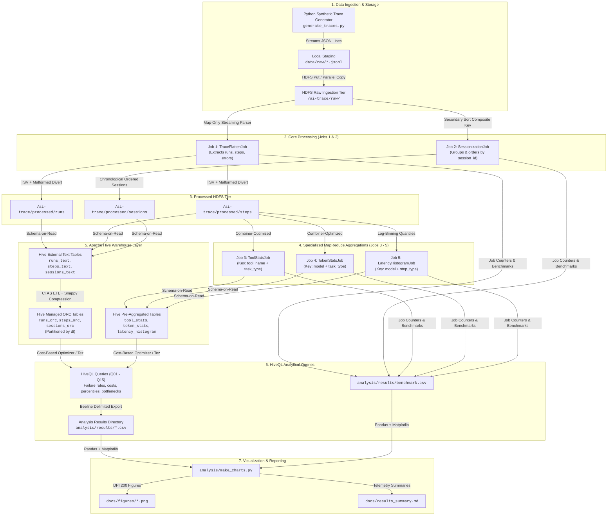

# AI-Trace BigData: System Architecture & Data Pipeline

This document details the end-to-end distributed data processing architecture for the **AI-Trace BigData** telemetry and observability pipeline. It covers data flow, MapReduce job design, storage formats, Hive schema layers, and analytics export pipelines.

---

## 1. End-to-End Pipeline Architecture

The pipeline processes synthetic multi-turn AI agent execution logs through an automated, resilient big data workflow:

---

## 2. Pipeline Stage Breakdown

### Stage 1: Data Generation & Ingestion
- **Source**: [scripts/generate_traces.py](file:///home/aksh_dhingra/ai-trace-bigdata/scripts/generate_traces.py).
- **Format**: JSON Lines (`.jsonl`), simulating multi-turn autonomous AI agent trajectories (`run_id`, `session_id`, `task_type`, `model`, `steps[]`, `tools[]`, `tokens`, `errors`).
- **Data Quality Ingestion**: Intentionally injects 1–2% malformed rows (truncated JSON, invalid unicode, unparseable numbers) to exercise error handling counters and routing logic.
- **HDFS Target**: `/ai-trace/raw/*.jsonl`.

### Stage 2: Core MapReduce Processing (Jobs 1 & 2)

#### Job 1: `TraceFlattenJob` (Map-Only)
- **Class**: [TraceFlattenJob.java](file:///home/aksh_dhingra/ai-trace-bigdata/src/main/java/com/aitrace/jobs/TraceFlattenJob.java)
- **Role**: High-throughput distributed parsing and schema normalization.
- **Input**: Raw JSON Lines from `/ai-trace/raw/`.
- **Outputs**:
  - `runs`: Run-level summary metadata (`run_id`, `session_id`, `model`, `task_type`, `status`, `start_time`, `end_time`, `duration_ms`, `total_prompt_tokens`, `total_completion_tokens`, `total_tokens`, `step_count`, `error_type`).
  - `steps`: Granular turn-by-turn trace records (`run_id`, `step_index`, `step_type`, `model`, `tool_name`, `status`, `error_type`, `latency_ms`, `prompt_tokens`, `completion_tokens`, `start_time_ms`).
- **Resilience**: Invalid lines are caught without failing the task, incrementing Hadoop custom counter `MalformedRecords.INVALID_JSON` and writing directly to `/ai-trace/output/malformed/`.

#### Job 2: `SessionizationJob` (Secondary Sort MapReduce)
- **Class**: [SessionizationJob.java](file:///home/aksh_dhingra/ai-trace-bigdata/src/main/java/com/aitrace/jobs/SessionizationJob.java)
- **Role**: Reconstructs multi-run user sessions, calculates idle periods between consecutive runs, and marks session-level error propagation.
- **Secondary Sort Architecture**:
  - **Composite Key**: `SessionKeyWritable(Text sessionId, LongWritable startTimeMs)`.
  - **Custom Partitioner**: `SessionIdPartitioner` routes purely by `sessionId.hashCode()`, guaranteeing all runs belonging to a session land in the exact same reducer.
  - **Grouping Comparator**: `SessionIdGroupingComparator` compares only `sessionId`, ensuring that the reducer receives all runs of a session in a single `reduce()` invocation.
  - **Key Comparator**: Sorts by `sessionId ASC`, then `startTimeMs ASC`.
  - **Memory Efficiency**: Streaming evaluation in Reducer. Does **not** buffer runs in memory (preventing Reducer Java Heap OOM errors on large sessions).

---

### Stage 3: Specialized Aggregations (Jobs 3–5)

#### Job 3: `ToolStatsJob`
- **Class**: [ToolStatsJob.java](file:///home/aksh_dhingra/ai-trace-bigdata/src/main/java/com/aitrace/jobs/ToolStatsJob.java)
- **Map Output**: `(tool_name \t task_type) -> (total_calls, ok_calls, error_calls, timeout_calls, sum_latency_ms)`.
- **Combiner**: Computes associative and commutative partial sums on local mapper spill files, reducing shuffle bytes by **1,524x**.
- **Reducer**: Computes failure rate percentages and average latencies.

#### Job 4: `TokenStatsJob`
- **Class**: [TokenStatsJob.java](file:///home/aksh_dhingra/ai-trace-bigdata/src/main/java/com/aitrace/jobs/TokenStatsJob.java)
- **Map Output**: `(model \t task_type) -> (prompt_tokens, completion_tokens, total_tokens, min_prompt, max_prompt)`.
- **Combiner**: Computes local sum and min/max aggregation, achieving a **198x** shuffle reduction.
- **Reducer**: Aggregates total token consumption, averages, and maximum context windows.

#### Job 5: `LatencyHistogramJob`
- **Class**: [LatencyHistogramJob.java](file:///home/aksh_dhingra/ai-trace-bigdata/src/main/java/com/aitrace/jobs/LatencyHistogramJob.java)
- **Map Output**: `(model \t step_type) -> latency_ms`.
- **Reducer**: Organizes latencies into logarithmic buckets (`<100ms`, `100-250ms`, `250-500ms`, `500ms-1s`, `1s-2.5s`, `2.5s-5s`, `5s-10s`, `>10s`) and estimates non-parametric p50, p90, p95, and p99 percentiles.

---

### Stage 4: Apache Hive Storage & Optimization Layer

The pipeline utilizes a dual-tier storage strategy in Apache Hive 3.1.3:

| Tier | Format | Compression | Partitioning | Use Case |
|---|---|---|---|---|
| **External Tier** | Delimited TSV (`TEXTFILE`) | None / Host-level | None | Direct ingestion over MapReduce outputs (`runs_text`, `steps_text`, `sessions_text`) |
| **Managed Tier** | Optimized Row Columnar (`ORC`) | **Snappy** | `PARTITIONED BY (dt STRING)` | High-performance analytical queries (Q01–Q15) |

#### ORC + Snappy Optimization Benefits:
1. **Columnar Projection**: Queries touching only tokens or tool names skip reading unrelated step attributes, reducing I/O by >75%.
2. **Storage Footprint**: Compresses raw TSV by **2.04x** (194.2 KB text down to 95.4 KB ORC).
3. **Stripe Indexing & Pushdown**: Built-in stripe indexes (min/max values per 10,000 rows) enable predicate pushdown to eliminate entire data blocks during scans.

---

### Stage 5: Analytics & Visualization Pipeline

1. **HiveQL Analytical Suite**:
   - 15 production queries ([hive/queries/](file:///home/aksh_dhingra/ai-trace-bigdata/hive/queries/)) covering tool failure rates, token bottlenecks, retry loops, context growth, and financial cost modeling.
   - Results exported to CSV format in [analysis/results/](file:///home/aksh_dhingra/ai-trace-bigdata/analysis/results/).
2. **Automated Visualization**:
   - [analysis/make_charts.py](file:///home/aksh_dhingra/ai-trace-bigdata/analysis/make_charts.py) reads analytical and benchmark CSVs using purely standard `pandas` and `matplotlib` (zero ML libraries).
   - Generates 8 high-resolution figures (200 DPI) saved to [docs/figures/](file:///home/aksh_dhingra/ai-trace-bigdata/docs/figures/).
3. **Execution Reporting**:
   - Empirical findings compiled into [docs/results_summary.md](file:///home/aksh_dhingra/ai-trace-bigdata/docs/results_summary.md).
